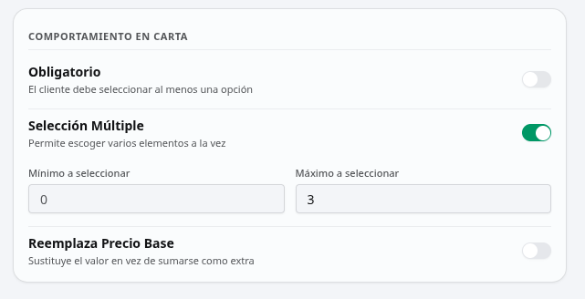
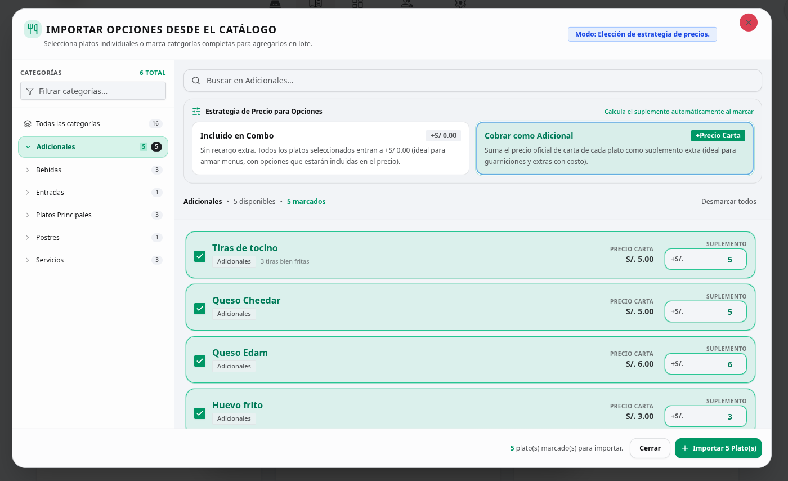
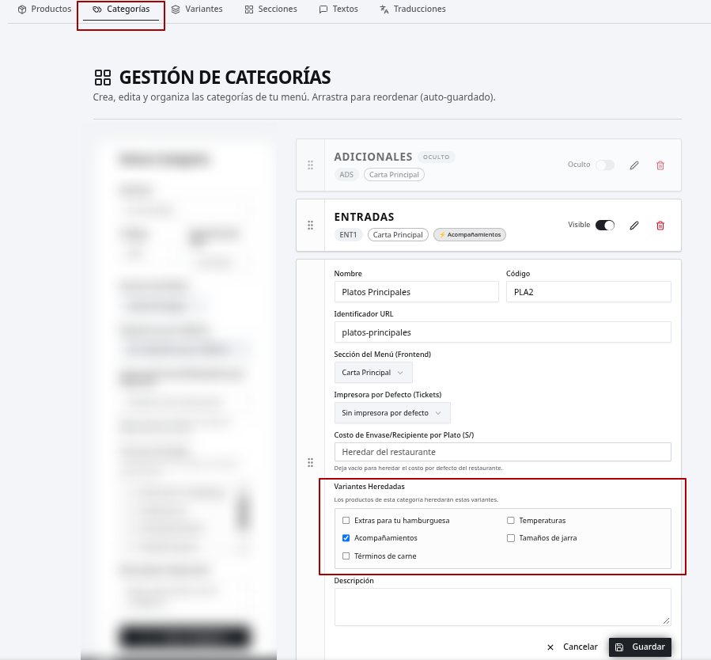
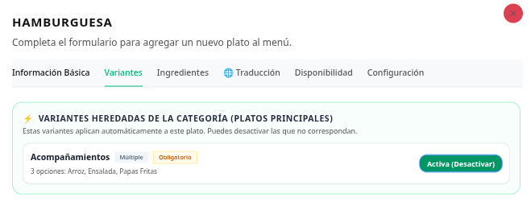
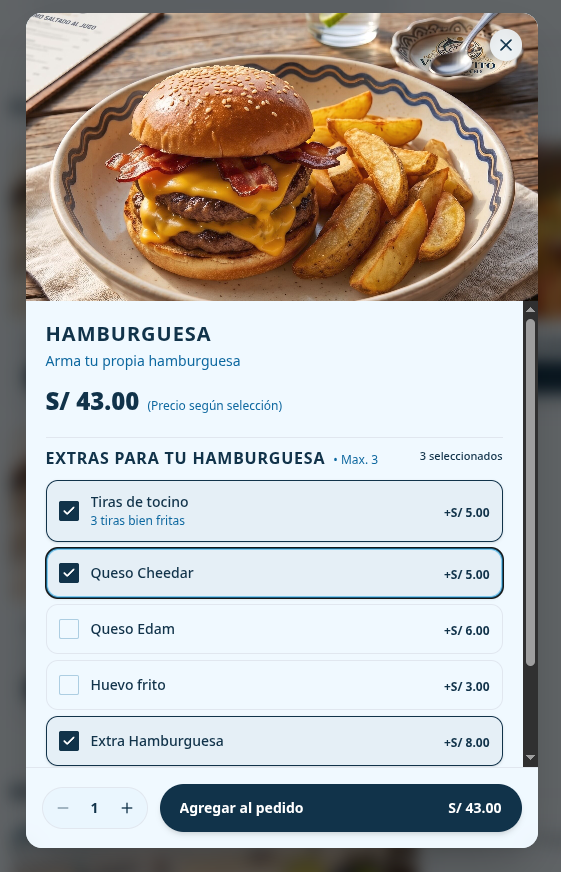

El **Sistema de Variantes** está diseñado para que tus clientes puedan personalizar sus platos de forma fácil en la carta pública (elegir tamaños, términos de cocción, sabores, guarniciones o ingredientes adicionales), mientras tu restaurante gestiona y controla todo de manera ágil y centralizada desde la plataforma de [Gestión de Negocio](https://app.viw-carta.com/backoffice).

---

## Objetivos del Sistema

* **Comunicación directa con cocina y trazabilidad completa:** Cada preferencia, alternativa o ingrediente extra queda registrado con total claridad y listo para enviar de inmediato a cocina en la comanda. Esta misma información alimenta de forma consistente los reportes de venta y la facturación, evitando discrepancias.
* **Toma de pedidos más ágil en el POS:** El personal de atención o caja registra las mismas preferencias en un par de toques, sin tener que memorizar precios ni escribir notas largas, garantizando que el pedido se arme correctamente desde el primer intento.
* **Presentación visual e interactiva en la carta pública:** Al tocar un plato con opciones, el cliente visualiza de inmediato una ventana donde puede elegir sus preferencias (como porciones, sabores o acompañamientos) con sus precios claros antes de agregar el producto al pedido.
* **Administración centralizada y ahorro de tiempo:** Permite organizar grupos de opciones una sola vez (por ejemplo: lista de guarniciones o salsas) y asignarlos de forma masiva a categorías completas, sin tener que configurar plato por plato.

---

## ¿Qué son las Variantes?

Tu carta no necesita decenas de platos repetidos para ofrecer variedad. Una **variante** es la herramienta que le da flexibilidad a un mismo producto base, permitiendo que el cliente decida exactamente cómo disfrutarlo.

En lugar de saturar el sistema registrando *"Pizza Mediana"*, *"Pizza Familiar"*, o creando un producto separado para cada término de carne o estilo de cerveza, mantienes un solo plato principal en tu menú y le asocias sus opciones disponibles.

### Los 2 Tipos Principales de Opciones

<CardGroup cols={2}>
  <Card title="1. Selección Única" icon="circle-dot">
    El cliente o el usuario que toma la orden debe elegir **exactamente una opción** de la lista para poder continuar.
    
    * **Ejemplos cotidianos:** Términos de cocción (1/2, 3/4, Bien cocido), estilos de cerveza artesanal (IPA, Red Ale, Porter), pizzas mitad y mitad, o tamaño/porción (Personal, Mediano, Familiar).
  </Card>

  <Card title="2. Selección Múltiple" icon="square-check">
    Permite al comensal o usuario marcar **una o varias opciones a la vez** para enriquecer el plato.
    
    * **Ejemplos cotidianos:** Toppings extras (tocino crocante, queso cheddar, huevo montado) o salsas a elección.
    * **Control de cantidades:** Permite fijar límites mínimos o máximos (ej. *"hasta 2 opciones"*) para definir la cantidad exacta permitida.
  </Card>
</CardGroup>

### ¿Cómo se maneja el Precio de cada opción?

Para evitar confusiones en caja y comanda, cada alternativa que configures puede tener una de estas tres reglas de precio:

1. **Incluida o Cortesía (+S/ 0.00):** La opción ya forma parte del costo del plato base o se ofrece como cortesía sin recargo alguno (ej. el término de la carne, o las dos salsas básicas de la casa).
2. **Suma de Adicional (+S/ X.XX):** Mantiene el precio base del plato y le suma el monto extra que tú definas. Ideal para toppings o cuando el cliente pide un upgrade (ej. agregar tocino por +S/ 3.50, o cambiar la gaseosa por cerveza artesanal por +S/ 4.00).
3. **Reemplazo del Precio Base:** La opción elegida determina por completo el nuevo precio final del plato. Es la configuración perfecta para tamaños o porciones (ej. Pizza Personal S/ 25.00, Mediana S/ 38.00, Familiar S/ 52.00).

<Tip>
**Caso 1: Creación de Promociones y Combos Pizzeros**  
*Ejemplo: "Combo Dúo: Pizza Grande + Bebida o Complemento" a S/ 45.00.*  
Creas un producto promocional base y le asocias variantes para armar la oferta de forma dinámica:
* **Elección de sabor (Única obligatoria):** Sabores clásicos incluidos a +S/ 0.00 (Americana, Pepperoni, Hawaiana), o un sabor gourmet con un adicional de +S/ 6.00 (Cuatro Quesos con Prosciutto).
* **Bebida o Acompañamiento (Única):** Gaseosa 1.5L incluida (+S/ 0.00), o un upgrade a 2 Cervezas Artesanales por +S/ 8.00.
* **Adicional opcional (Múltiple):** Porción de Pan al Ajo simple (+S/ 6.00) o Pan al Ajo especial con queso mozzarella (+S/ 9.00).
</Tip>

<Tip>
**Caso 2: Experiencia "Arma tu Plato" por Pasos (Bowls o Salchipapas Gourmet)**  
Estructuras el producto en pasos lógicos:
1. **Paso 1 (Selección Única):** Elige la base (Papas nativas o Quinua).
2. **Paso 2 (Selección Única):** Elige la proteína (Salchicha artesanal, Pollo crocante o Lomo).
3. **Paso 3 (Selección Múltiple con límite):** Elige hasta 3 salsas o toppings extra.  
Cocina recibe la comanda ordenada paso a paso y caja cobra automáticamente cualquier ingrediente extra.
</Tip>

---

## Crear una nueva Plantilla de Variantes

Las variantes se administran como **Plantillas Reutilizables**. Esto significa que solo configuras el grupo de opciones una sola vez y luego puedes asociarlo a uno o a decenas de platos.

<Steps>
  <Step title="Ingreso al módulo">
    Desde tu panel de administración, ve al menú lateral y entra en [Gestión de Carta > Variantes](https://app.viw-carta.com/backoffice/menu/variants) y toca el botón **Nueva Plantilla**.
  </Step>

  <Step title="Datos generales del grupo">
    * **Nombre de la plantilla:** Escribe cómo verá el grupo el cliente o colaborador (ejemplos: *"Elige el Tamaño"*, *"Sabores de Pizza"*, *"Toppings Adicionales"*, *"Término de la Carne"*).
    * **Descripción (Opcional):** Una breve indicación de apoyo si lo consideras necesario (ejemplo: *"Selecciona hasta 2 salsas de la casa"*).
  </Step>

  <Step title="Configurar el comportamiento de la opción">
    Define cómo debe interactuar el comensal con estas opciones mediante 3 interruptores simples:
    * **¿Es Obligatorio?:** Actívalo si el cliente o colaborador no puede agregar el plato al pedido sin haber escogido al menos una alternativa (ideal para tamaños, términos de cocción o sabores de pizza).
    * **¿Múltiples opciones?:**
      * *Desactivado:* Funciona como selección única (solo permite elegir una alternativa).
      * *Activado:* Permite marcar varias opciones a la vez (ideal para adicionales y toppings). Puedes fijar un límite máximo.
    * **¿Reemplazar precio base?:** Actívalo únicamente si la opción elegida debe reemplazar por completo el precio original del plato (la regla de oro para tamaños: Personal, Mediana o Familiar).

    <Frame caption="Configuración de interruptores de la plantilla de variantes">
      
    </Frame>
  </Step>

  <Step title="Cargar las opciones (Manual o desde tu Catálogo)">
    Para armar la lista de alternativas tienes dos botones directos:
    
    1. **Opción Manual (Escribir a mano):** Agrega una fila vacía para que digites una opción desde cero con su nombre en español, inglés, descripción y precio o costo del complemento.
    2. **Importar del Catálogo (Selector de Platos):** Abre una ventana visual interactiva para reutilizar de inmediato platos que ya existen en tu menú:
       * **Navegación por Categorías o Buscador:** Explora la barra lateral de categorías o busca por nombre en tiempo real.
       * **Selección individual o por lote:** Marca casillas o usa **Seleccionar todos**.
       * **Estrategia de Precio Inteligente:**
         * *Opciones Incluidas (+S/ 0.00):* Sin recargo extra (ideal para guarniciones o bebidas de menú).
         * *Cobrar como Adicional (+Precio Carta):* Asigna automáticamente el precio de venta oficial.
       * **Ajuste de precio al vuelo:** Modifica libremente el importe antes de importar.
       * **Protección contra duplicados:** Los platos ya añadidos muestran la etiqueta *"Ya en plantilla"*.

    <Frame caption="Selector interactivo de opciones desde el catálogo">
      
    </Frame>
  </Step>

  <Step title="Guardar">
    Haz clic en **Guardar**. Tu plantilla quedará lista en la lista general de variantes para ser asignada a los platos que desees.
  </Step>
</Steps>

---

## Asignación Masiva a Categorías y Excepciones por Producto

### 1. Asignar variantes a Categorías enteras (Herencia Automática)

Para no perder tiempo configurando las opciones producto por producto, el sistema te permite vincular una o varias plantillas a toda una categoría:

1. En tu panel de administración, ve a [Gestión de Carta > Categorías](https://app.viw-carta.com/backoffice/menu/categories).
2. Al crear o editar una categoría (ej. *"Pizzas Artesanales"* o *"Cortes a la Parrilla"*), ubica la sección **Plantillas de Variantes (Heredadas)**.
3. Marca las casillas de las plantillas que corresponden a esa categoría.
4. Guarda la categoría.  
   **Listo:** Todos los productos de esa sección —e incluso los que crees a futuro— adoptarán estas opciones automáticamente.

<Frame caption="Asignación masiva de plantillas heredadas a una categoría">
  
</Frame>

### 2. Manejo de Excepciones: Personalizar o excluir en un producto específico

En la cocina siempre existen excepciones. Por ejemplo: en la categoría *"Parrillas"*, un *Carpaccio* o un *Tartar* no requiere término de cocción; o una pizza promocional solo se vende en tamaño fijo.

* **Para apagar una opción heredada en un solo producto:**
  1. Ve a **Gestión de Carta > [Productos](https://app.viw-carta.com/backoffice/menu)** y edita el producto.
  2. Entra a la pestaña **Variantes**.
  3. En el bloque superior **⚡ Variantes Heredadas de la Categoría**, pulsa el botón verde **Activa (Desactivar)** en la que no corresponda.
* **Para agregar Variantes Propias exclusivas:**
  * En la sección inferior **Variantes Propias de este Plato**, crea opciones que solo se mostrarán al pedir ese producto específico.

<Frame caption="Gestión de excepciones y variantes propias por producto">
  
</Frame>

---

## La Experiencia en Acción: De la Pantalla a la Cocina

<CardGroup cols={2}>
  <Card title="1. En la Carta Digital Pública" icon="mobile-screen">
    * **Botón Inteligente:** Si el producto tiene variantes, invita al cliente a *"Elegir Opciones"*.
    * **Ventana Intuitiva:** Valida elecciones obligatorias y límites máximos con precios claros.
    * **Carrito y WhatsApp:** Las elecciones aparecen desglosadas limpiamente bajo el producto.
  </Card>

  <Card title="2. En el Punto de Venta (POS)" icon="cash-register">
    * **Registro en 2 toques:** Selección inmediata sin cálculos mentales ni textos libres.
    * **Cero pedidos incompletos:** El sistema bloquea el envío si falta una selección obligatoria.
  </Card>

  <Card title="3. En Cocina y Despacho" icon="kitchen-set">
    * **Comanda térmica y pantalla clara:** Opciones impresas con sangría bajo el plato principal.
    * **Trazabilidad servido vs. cobrado:** Seguridad de que todo extra preparado fue registrado.
  </Card>

  <Card title="4. Reportes y Finanzas" icon="chart-line-up">
    * **Caja y ventas 100% exactas:** Cada adicional cobrado se suma al precio vendido sin fugas de dinero.
    * **Historial auditable:** Cada ticket guarda el desglose exacto de las opciones vendidas.
    * **Integración contable:** Subtotales e IGV automáticos sin descuadres al cierre.
  </Card>
</CardGroup>

<Frame caption="Experiencia interactiva del comensal en la Carta Digital Pública">
  
</Frame>
